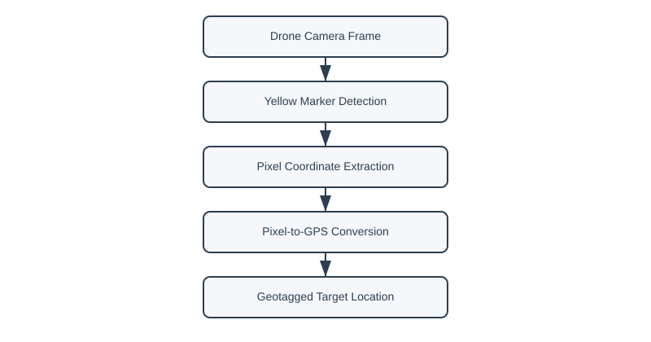

# Onboard Crop-Stress Detection and Geotagging for a Dual-UAV Precision-Agriculture System

Perception and localization modules of the scout drone in the IvLabs **Dual-UAV Scan-and-Spray** system: detect crop-stress markers in aerial images onboard, and convert each detection into a GPS target for the sprayer drone.

> Part of: R. Deshmukh\*, S. Biswas\*, *et al.*, "Autonomous Parallel Scan-and-Spray Dual-UAV Collaboration for Precision Agriculture Using Onboard Vision," *ASME Letters in Translational Robotics*, 2026 (in press). \*Equal contribution.
> Full system: [IvLabs/Dual_UAV_Scan-and-Spray_for_Precision_Agriculture](https://github.com/IvLabs/Dual_UAV_Scan-and-Spray_for_Precision_Agriculture) · Ignite Prize, NIDAR 2026.

<p align="center">
  
</p>

## Overview
| Stage | Method |
|---|---|
| Detection | HSV colour segmentation with a dual-region mask; neutral-density (ND) filter at capture to suppress midday glare |
| Filtering | Morphological cleanup and area thresholds to reject reflections and background artefacts |
| Geotagging | Pinhole camera model + UAV pose (GPS, altitude, attitude) → target latitude/longitude |
| Output | Geotagged targets sent to the sprayer drone for targeted spraying |

Runs onboard an **NVIDIA Jetson Orin Nano** during flight.

## Results
- Detection recall improved from ~10–15% to ~95% after dual-mask + ND-filter preprocessing.
- Field-validated as part of the full system on a 2-acre farm.

## Repository structure
```
Yellow_detection.py      # detection + geotagging pipeline (main entry point)
pixel2gps.py             # pixel-to-GPS conversion utilities
pipeline_diagram.svg     # perception pipeline
workflow_diagram.svg     # mission workflow
```

## Usage
```bash
pip install opencv-python numpy
python Yellow_detection.py
```

## Citation
```bibtex
@article{deshmukh2026scanspray,
  title   = {Autonomous Parallel Scan-and-Spray Dual-UAV Collaboration for Precision Agriculture Using Onboard Vision},
  author  = {Deshmukh, Rajasi and Biswas, Samiron and Ayush, Kumar and Watgule, Sunil and Anand, Abhinav and Kayala, Tarun and Kothari, Ashwin},
  journal = {ASME Letters in Translational Robotics},
  year    = {2026},
  note    = {In press}
}
```

## License
MIT — see `LICENSE`.
